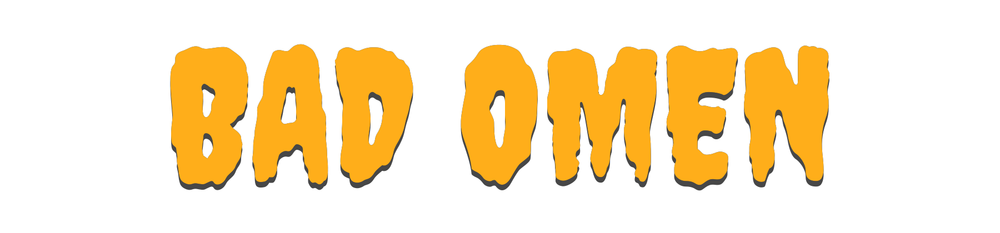
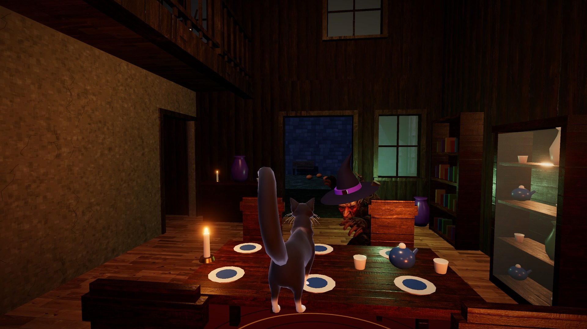

# BAD OMEN



**One cat. Two floors. No deposit refunds.**
A third-person cat-chaos physics comedy, made in 24 hours for **Game Jam Europe 2026** by team **Fractured Sanity**
(Arjun Vinod), starring the jam's mascot, **Kömür the black cat**.

- **Play in the browser:** https://aj-insanity.itch.io/bad-omen
- **Download the game (web build, v1.8-jam):** [`release/bad-omen-web.zip`](release/bad-omen-web.zip): unzip it and
  serve the folder with any static web server (see below), or upload it as an HTML5 game.



## Who's the real bad omen?

A superstitious witch-grandma is sure the black cat in her cottage is bad luck. In BAD OMEN she is right about the
disasters and wrong about the culprit: Kömür is just a cat, and his paws can't snap a rope or bring down a roof. He
knocks the china about, meows, taunts and dodges, and her own thrown pans, axes and pitchforks do the rest: the
chandelier, the kitchen fire, the bedroom floor, the glass-roofed conservatory and finally the roof. The rules make the
point: the house's weak points break only under Grandma's throws, and every disaster she causes scores
**GRANNY DID IT ×2**.

## Features

- A cat that moves like one: graceful walk, gallop with drift turns, aimed leaps onto tables and mantels, pounce, swipe,
  meow, hide, sneak and scratch; left alone, Kömür licks his paw, sits and settles into a loaf.
- About 375 breakable things that stay broken: physics fracture and persistent debris (Rapier), chain-reaction combos.
- Grandma: sight and hearing, chases across both floors and the garden, telegraphed throws, catches, rage phases up to
  MELTDOWN.
- Five cinematic disasters plus four bonus disasters, two endings (dawn over the ruins, or the cauldron), 16
  achievements.
- 77 voiced, subtitled lines; music that follows the chase (a creepy waltz, chase music, a meltdown), every change on
  the beat.
- Keyboard and mouse on desktop, or touch controls on a phone or tablet in landscape.

## Controls

| Input | Action |
|---|---|
| WASD + mouse | Walk / look |
| Shift | Gallop (turn hard at speed to drift) |
| Space | Leap onto the ledge ahead (the amber ring shows where), otherwise a hop |
| Left click / Right click | Paw swipe / pounce |
| F | Meow, taunt Grandma (baits her throws) |
| E | Hide (under tables, the bed, the stairs); hold to scratch ropes and weak spots |
| C | Crouch / sneak |
| Esc / M / Tab | Pause / mute / skip the tutorial |

**Touch (landscape):** drag on the left half to walk (push the stick to its rim to gallop), drag on the right half to
look; buttons for swipe, jump, pounce, meow and hide.

## Run from source

Requires Node 22+ and a browser with WebGL2 (Chrome, Edge or Firefox).

```bash
npm ci               # install the exact dependency versions
npm run dev          # http://localhost:5173, then click Play
npm run build        # production build in dist/ (static files, relative paths)
npm run preview      # serves dist/ on http://localhost:4173
npm run package      # dist/ zipped for itch.io: submission/bad-omen-web.zip
npm test             # unit tests (scoring, combos, rage, finale gating)
```

The release zip in `release/` is `npm run package` at tag `v1.8-jam`; a build from this repository reproduces it file
for file.

## Project structure

| Path | What it is |
|---|---|
| `src/game/` | Game loop, director (tutorial, quests, dialogue cues), set pieces, scoring rules, achievements, cutscenes |
| `src/player/Cat.js` | Kömür: the character controller (Rapier kinematic), gaits, leaps, swipes, idle life, procedural spine/tail/head |
| `src/ai/` | Grandma's AI (perception, A* navigation across both floors, chase, throws, catches) and the thrown projectiles |
| `src/world/` | The procedural cottage, breakable props, fracture and debris, fire, materials, the light pool |
| `src/audio/`, `src/fx/`, `src/camera/`, `src/core/`, `src/ui/` | Music director and sound, effects, follow camera, input (incl. touch), physics wrapper, HUD and menus |
| `public/` | Game assets: character GLBs, KTX2 and JPG textures, voices, music, sound effects |
| `tools/blender/` | Headless Blender pipeline: Kömür's recolour and 38 procedural animations, Grandma's Mixamo merge, GLB export |
| `tools/` (other) | Audio preparation, KTX2 texture encoding, video and still tools |
| `scripts/` | Browser test suites (Playwright), asset/voice generation, the trailer capture, packaging |
| `docs/` | The original game design documents |
| `project_notes/` | Development log: progress, decisions and executed test results |
| `submission/` | Jam submission material: screenshots, pitch deck, presentation, QA checklist |

## Tests

```bash
node scripts/browser_smoke.mjs http://localhost:5173/   # 16 end-to-end checks in a real browser
node scripts/qa_probe.mjs http://localhost:5173/        # 27 targeted probes (Grandma never stuck, the catch hold, ...)
node scripts/input_test.mjs http://localhost:5173/      # real mouse and keyboard
node scripts/music_test.mjs http://localhost:5173/      # music transitions
node scripts/mobile_test.mjs http://localhost:5173/     # phone in landscape with real multi-touch
node scripts/stress_test.mjs http://localhost:5173/     # mass destruction, frame rate, every set piece
node scripts/itch_like_server.mjs <extracted zip>       # serve a build like itch.io (case-sensitive) to test through
```
All automated browsers run muted. Results are logged in `project_notes/TEST_RESULTS.md`.

## Rebuilding assets (optional)

- Characters: `npm run assets:blender` (headless Blender 5.2) from the licensed source packs, which are not in this
  repository: put them in `assets_inbox/` (see `assets_inbox/README.md`).
- Voices and sound effects were generated with ElevenLabs at build time (`npm run voices`, `scripts/generate_sfx.mjs`);
  they need your own API key in a local `.env`, which is never committed or shipped.
- Music: `python tools/audio/prep_music.py`.

## Licenses

- **Source code:** MIT, see [LICENSE](LICENSE).
- **Third-party assets** keep their own licenses and are not covered by the MIT license (full list in
  [CREDITS.md](CREDITS.md)):
  - Kömür's base model: "Somali Cat Animated ver 1.2" by DreamNoms, CC BY 4.0 (recoloured and re-animated here).
  - Grandma: the "Goblin D Shareyko" character and animations from Adobe Mixamo, under Mixamo's terms: included as
    part of the game only, not for reuse as standalone assets.
  - Wood textures: Poly Haven, CC0. Fonts: Creepster and IM FELL English, SIL Open Font License.
  - Music: "Halloween Suspense Horror Halloween Waltz" by Bombinsound (Pixabay Content License: part of the game only,
    not for standalone redistribution). Chase and meltdown music, voices and sound effects generated with ElevenLabs.
